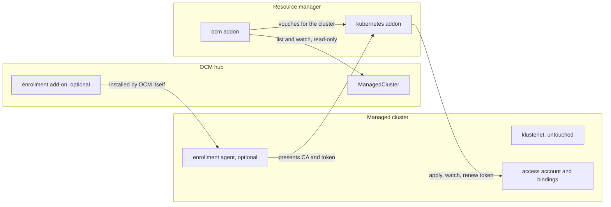

# Existing Clusters and OCM Hubs

## What this doc covers

How the resource manager takes in Kubernetes clusters it did not create, and how it works beside Open Cluster Management (OCM) hubs:

- enrollment: a capability of the kubernetes addon that turns an existing cluster into an ordinary `kubernetes` target
- the access piece a cluster's administrator applies, and the credential the platform holds for it
- the two ways a cluster presents itself: through an OCM add-on on its hub, or through a manifest applied to it
- the rule for when the stored credential applies intent
- withdrawal from either side
- the ocm addon: hub connections, observed clusters, links, and hub facts as target labels
- the console pages for all of it
- what is deliberately not built

## When to read this

Read this when you are working on enrollment in the kubernetes addon, on the ocm addon or its console plugin, or when you need to understand how a cluster that an OCM hub manages becomes a target without leaving that hub.

## What is intentionally elsewhere

- Requirements, use cases, and the gap ledger for introducing the resource manager to OCM: [../shim/README.md](../shim/README.md)
- Delivery to and indexing of a Kubernetes target, once it exists: [kubernetes-inventory-and-delivery.md](kubernetes-inventory-and-delivery.md)
- Credential presentation and `PausedAuth`: [../authentication.md](../authentication.md)
- Provenance, attestation, and trust configuration: [../architecture/provenance.md](../architecture/provenance.md)
- Addon lifecycle and capability model: [../architecture/addon_integration.md](../architecture/addon_integration.md)
- Resource identity and the two-layer API: [../architecture/resource_identity_and_api.md](../architecture/resource_identity_and_api.md)
- Running it in the all-in-one sandbox: [../../../deploy/aio/README.md](../../../deploy/aio/README.md#existing-clusters-and-ocm-hubs)

## Overview

Two addons share the work, and the split is the design.

The **kubernetes addon** owns everything about a cluster: verifying what a cluster presents, storing and renewing its credential, registering the target, starting the indexer, and undoing all of it. It knows nothing about OCM. A cluster enrolled this way is a `kubernetes` target like one the kind addon created, so delivery, indexing, placement, and the console treat it the same.

The **ocm addon** owns everything about a hub: the read-only connection, the record of each cluster the hub reports, the link between such a record and a cluster the platform already knows, and the hub's labels on the targets of enrolled clusters. It vouches for a cluster during enrollment and otherwise stays out of the path. No delivery goes through a hub, and a hub that cannot be reached does not stop delivery to its enrolled clusters.

The platform writes nothing to a hub, and nothing to a cluster that has not opted in. Each step that changes another system returns a manifest for that system's administrator to apply.

## Enrollment

### What a cluster adds

The access piece is a namespace, a service account in it, role bindings for the rights its administrator chose, and a role that lets the account request a token for itself. All are built-in kinds, and nothing has to keep running on the cluster.

A profile decides the rights: cluster administrator; workloads, which binds the built-in `edit` role and adds reading at cluster scope, without secrets, and the creation of namespaces; read-only, which binds the built-in `view` role and the same reading; or a cluster role the administrator names. The platform reports the rights it finds on the cluster, not the ones that were asked for.

### How a cluster presents itself

An enrollment is authorized by an **enrollment bundle**: a secret scoped either to one cluster or to the clusters that one verifier vouches for. For the ocm addon a verifier's scope is one hub. The bundle fixes the profile, the labels, and whether platform delivery is granted. The platform keeps only a hash of the secret.

A small **enrollment agent** on the cluster requests a short-lived token for the access account, reads the cluster's CA, and presents both with the bundle's secret. It runs once, as a job, when a manifest is applied to the cluster. Through an OCM add-on it runs for as long as the add-on is enabled for the cluster, and presents again before the token expires. A person can also present a token through the authenticated API.

### What is verified

The address is never taken from the presenter. It comes from the bundle, or from the verifier's record of the cluster. Where the verifier holds a CA for the cluster, the presented CA must equal it, and the presented CA is the only trust root for the probe. The credential is tried against the cluster and must name the expected service account.

A check that fails creates nothing: no target, no stored credential, no record. A cluster whose address and CA already belong to another target is refused as already known, so one cluster has one target.

### What enrollment creates

- the credential, in the secret store only
- a `kubernetes` target with the cluster's address and CA, trust settings, and labels
- a cluster record that says who enrolled it, by which route, and with which rights
- an indexer for the target

The platform renews the credential itself through the cluster's token API before it expires, with nothing running on the cluster. A credential that lapses takes the target out of placement until the cluster presents again; the record then says that the cluster needs enrollment.

### The rule for the stored credential

Each enrolled target declares when its stored credential applies intent. By default that is only intent that carries a verified signature. An explicit grant, made at enrollment and recorded with who made it, also lets it apply unsigned intent of an authenticated caller. Without the grant, unsigned intent goes with the caller's own token, and the stored credential is never tried in its place.

This keeps the standing credential from turning every authenticated caller into its holder by default, and makes the wider rule a visible decision of whoever enrolls the cluster.

### Withdrawal

From the platform's side, withdrawal stops the indexer and removes the target, the credential, and the indexed objects. The record stays, and says who withdrew the cluster and why. Withdrawal is refused while deployments still resolve to the target, unless the caller says they are to be left; what they delivered then stays on the cluster.

From the cluster's side, removing the access piece is enough. After repeated refusals of the credential the platform runs the same release itself and records that the cluster withdrew.

A withdrawn cluster is not enrolled again by a bundle older than the withdrawal. Forgetting the record, or a newer bundle, is the explicit act that allows it.

## The ocm addon

### Hub connections

A hub is connected with a credential that may read managed clusters and cluster sets and request its own token, and nothing else. The platform shows the manifest for that account before it asks for anything, and the hub's administrator applies it. The connection reports whether its credential could also write.

One watch per hub keeps a record for each cluster with its labels, cluster set, claims, and conditions. While a hub cannot be reached, its records keep their last values and are marked stale. Disconnecting removes the hub's records, its credential, and the bundles scoped to it; clusters that were enrolled through it stay enrolled.

### Observed clusters and links

A cluster that a hub reports is an inventory record, not a target. It can be listed and searched, and intent that names it is refused with that reason.

The addon links a record to a cluster the platform already knows by, in order: the enrollment's own record of the hub and name it came through; the API address together with the CA; and the name, only where the hub records no address for the cluster and exactly one known cluster carries it. The basis is stored with the link. Where several candidates fit, none is linked and the conflict is reported. A cluster that is known both ways appears once.

### Enrollment through a hub

For a connected hub the platform renders an OCM `AddOnTemplate` and `ClusterManagementAddOn`. They carry the access piece, the enrollment agent, and a bundle scoped to that hub. The hub's administrator applies them and enables the add-on for the clusters that are to enroll; OCM's own add-on manager and work agent install them. The ocm addon vouches for a presenting cluster only if the hub knows it and has accepted it.

Disabling the add-on for a cluster removes the agent and leaves the access piece. The cluster stays enrolled, with nothing running on it for the platform and nothing on the hub for it.

### Hub facts as labels

The target of an enrolled cluster carries the hub's labels, which include its cluster set, its claims under a prefix, and two labels that name the hub and the cluster. They follow the hub. A label given at enrollment wins over a hub label of the same key. Label selection in placement therefore works with the labels people already use on the hub, and keeps working while the hub is away.

## Console

The core plugin lists created, enrolled, and observed clusters in one list and one search, one row per cluster, with its origin, hub, and state. An enrolled cluster has the pages of a created one. The targets page reads the registered targets.

The ocm plugin adds the page of connected hubs, the step that connects a hub, the dialog that returns what enrolls a hub's clusters, a tab on a cluster's page with the hub's record, and a search renderer for observed clusters. The console shows manifests for an administrator to apply; it applies nothing to a hub or to a cluster.

## Limits and what is not built

- Only the direct form exists: the platform must be able to reach the cluster's API. An agent that dials out from the cluster is not built.
- Decisions of an OCM `Placement` are not copied onto targets.
- A hub gets no default profile of its own, and what is indexed cannot be narrowed per cluster.
- The enrollment and hub operations are plain JSON over HTTP contributed by the addons. They are not yet part of the protobuf API or of the command line.
- The add-on template carries the bundle's secret, so anyone who can read add-on templates on the hub can read it. The secret lets a cluster that the hub knows present itself, and nothing else.
- Deleting a deployment always removes what it applied. Only a withdrawal can leave delivered resources in place.
- The console does not withdraw a cluster or issue a bundle for a cluster without a hub.
- Both addons are compiled into the resource manager, like the other addons today.
