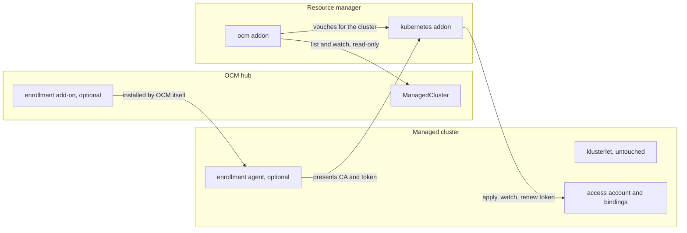

# Existing Clusters and OCM Hubs

## What this doc covers

How the resource manager takes in Kubernetes clusters it did not create, and how it works beside Open Cluster Management (OCM) hubs:

- enrollment: a capability of the kubernetes addon that turns an existing cluster into an ordinary `kubernetes` target
- the access piece a cluster's administrator applies, and the credential the platform holds for it
- the two ways a cluster presents itself: through an OCM add-on on its hub, or through a manifest applied to it
- the rule for when the stored credential applies intent
- withdrawal from either side
- the ocm addon: hub connections, observed clusters, links, and hub facts as target labels
- several hubs under one resource manager: what stays with each hub
- what a deployment cannot reach on a cluster that a hub manages or runs on
- the console pages for all of it
- what is deliberately not built

## When to read this

Read this when you are working on enrollment in the kubernetes addon, on the ocm addon or its console plugin, or when you need to understand how a cluster that an OCM hub manages becomes a target without leaving that hub.

## What is intentionally elsewhere

- Requirements, use cases, and the gap ledger for introducing the resource manager to OCM: [../shim/README.md](../shim/README.md)
- A walkthrough of connecting a hub and enrolling its clusters, from a fresh clone: [../../../deploy/aio/existing-clusters-walkthrough.md](../../../deploy/aio/existing-clusters-walkthrough.md)
- A short demo with two hubs, in eight steps with screenshots: [../../../poc/shim/README.md](../../../poc/shim/README.md)
- Every request with its body, answer, and refusal reasons: [../../existing-clusters-api.md](../../existing-clusters-api.md)
- Delivery to and indexing of a Kubernetes target, once it exists: [kubernetes-inventory-and-delivery.md](kubernetes-inventory-and-delivery.md)
- Credential presentation and `PausedAuth`: [../authentication.md](../authentication.md)
- Provenance, attestation, and trust configuration: [../architecture/provenance.md](../architecture/provenance.md)
- Addon lifecycle and capability model: [../architecture/addon_integration.md](../architecture/addon_integration.md)
- Resource identity and the two-layer API: [../architecture/resource_identity_and_api.md](../architecture/resource_identity_and_api.md)
- Running it in the all-in-one sandbox: [../../../deploy/aio/README.md](../../../deploy/aio/README.md#existing-clusters-and-ocm-hubs)

## Overview

Two addons share the work, and the split is the design.

The **kubernetes addon** owns everything about a cluster: verifying what a cluster presents, storing and renewing its credential, registering the target, starting the indexer, and undoing all of it. It knows nothing about OCM. A cluster enrolled this way is a `kubernetes` target like one the kind addon created, so delivery, indexing, placement, and the console treat it the same.

The **ocm addon** owns everything about a hub: the read-only connection, the record of each cluster the hub reports, the link between such a record and a cluster the platform already knows, and the hub's labels on the targets of enrolled clusters. It vouches for a cluster during enrollment and otherwise stays out of the path. No delivery goes through a hub, and a hub that cannot be reached does not stop delivery to its enrolled clusters.

The platform writes nothing to a hub, and nothing to a cluster that has not opted in. Each step that changes another system returns a manifest for that system's administrator to apply.

## Enrollment

### What a cluster adds

The access piece is a namespace, a service account in it, role bindings for the rights its administrator chose, and a role that lets the account request a token for itself. All are built-in kinds, and nothing has to keep running on the cluster.

A profile decides the rights: cluster administrator; workloads, which binds the built-in `edit` role and adds reading at cluster scope, without secrets, and the creation, change, and deletion of namespaces, so that a deployment can bring its namespace and its removal can take the namespace away again; read-only, which binds the built-in `view` role and the same reading; or a cluster role the administrator names. The platform reports the rights it finds on the cluster, not the ones that were asked for.

### How a cluster presents itself

An enrollment is authorized by an **enrollment bundle**: a secret scoped either to one cluster or to the clusters that one verifier vouches for. For the ocm addon a verifier's scope is one hub. The bundle fixes the profile, the labels, and whether platform delivery is granted. The platform keeps only a hash of the secret.

A small **enrollment agent** on the cluster requests a short-lived token for the access account, reads the cluster's CA, and presents both with the bundle's secret. It runs once, as a job, when a manifest is applied to the cluster. Through an OCM add-on it runs for as long as the add-on is enabled for the cluster, and presents again before the token expires. A person can also present a token through the authenticated API.

### What is verified

The address is never taken from the presenter. It comes from the bundle, or from the verifier's record of the cluster. Where the verifier holds a CA for the cluster, the presented CA must equal it, and the presented CA is the only trust root for the probe. The credential is tried against the cluster and must name the expected service account.

A check that fails creates nothing: no target, no stored credential, no record. A cluster that already belongs to another target is refused as already known, so one cluster has one target. Where the presented credential may read it, the cluster's own identifier decides that: the UID of its `kube-system` namespace, which is the same at whatever address the cluster is reached. Without it, the address together with the CA decides.

### What enrollment creates

- the credential, in the secret store only
- a `kubernetes` target with the cluster's address and CA, trust settings, and labels
- a cluster record that says who enrolled it, by which route, and with which rights
- an indexer for the target

The platform renews the credential itself through the cluster's token API before it expires, with nothing running on the cluster. A credential that lapses leaves everything in place: the target stays registered and is marked not ready until the cluster presents again, and the record says that the cluster needs enrollment. While it is not ready, no deployment is newly placed on it, the deployments it holds keep it, and nothing is removed from it. A delivery that needs the stored credential in that time fails and is retried, and goes through once the cluster has presented again.

### The rule for the stored credential

Each enrolled target declares when its stored credential applies intent. By default that is only intent that carries a verified signature. An explicit grant, made at enrollment and recorded with who made it, also lets it apply unsigned intent of an authenticated caller. Without the grant, unsigned intent goes with the caller's own token, and the stored credential is never tried in its place.

This keeps the standing credential from turning every authenticated caller into its holder by default, and makes the wider rule a visible decision of whoever enrolls the cluster.

### Withdrawal

From the platform's side, withdrawal stops the indexer and removes the target, the credential, and the indexed objects. The record stays, and says who withdrew the cluster and why. Withdrawal is refused while deployments still resolve to the target, unless the caller says they are to be left; what they delivered then stays on the cluster.

A withdrawal removes nothing from the cluster, whatever the deployments do next. From the moment it starts, nothing is dispatched to the cluster's target: a deployment placed by label drops the cluster from its placement without a removal, even when it goes on running elsewhere, and a deployment that names the target keeps naming it and is otherwise left as it is. Deleting such a deployment afterwards removes it from the targets that are still registered and finishes.

From the cluster's side, removing the access piece is enough. After repeated refusals of the credential the platform runs the same release itself and records that the cluster withdrew.

A withdrawn cluster is not enrolled again by a bundle older than the withdrawal. Forgetting the record, or a newer bundle, is the explicit act that allows it.

## The ocm addon

### Hub connections

A hub is connected with a credential that may read managed clusters and cluster sets, read the one namespace whose UID identifies the hub, and request its own token, and nothing else. The platform shows the manifest for that account before it asks for anything, and the hub's administrator applies it. The account has a namespace and a label of its own, apart from a cluster's access piece: a hub that is registered with itself can be enrolled like any cluster, and removing that cluster's access piece must not end the hub's connection. The connection requires the credential to list and watch managed clusters; it also asks whether the credential could write — update or delete managed clusters, create manifest works — and reports the answer in `writeAccessFound`, accepting the credential either way.

A hub is one connection. The UID of the hub's `kube-system` namespace is kept as the hub's identifier: the same hub is refused under a second id at whatever address it is given, and a connected hub that is given at a new address under its own id is the same connection, moved. Where an identifier is missing on either side, the address and CA decide as far as they can: the same address and CA are the same hub, and another address under an id in use is refused.

One watch per hub keeps a record for each cluster with its labels, cluster set, claims, and conditions. While a hub cannot be reached, its records keep their last values and are marked stale, also when the resource manager starts while the hub is away and has only the records it stored before. Disconnecting removes the hub's records, its credential, and the bundles scoped to it; clusters that were enrolled through it stay enrolled.

### Observed clusters and links

A cluster that a hub reports is an inventory record, not a target. It can be listed and searched, and intent that names it is refused with that reason.

The addon links a record to a cluster the platform already knows by, in order: the enrollment's own record of the hub and name it came through; the cluster's own identifier, where the hub publishes it as the cluster claim `id.k8s.io`; the API address together with the CA; and the name, only where the hub records no address for the cluster, exactly one known cluster carries it, and no other connected hub has a cluster of that name without an address. The basis is stored with the link. Where several candidates fit, none is linked and the conflict is reported. A cluster that is known both ways appears once.

### Enrollment through a hub

For a connected hub the platform renders an OCM `AddOnTemplate` and `ClusterManagementAddOn`. They carry the access piece, the enrollment agent, and a bundle scoped to that hub. The hub's administrator applies them; OCM's own add-on manager and work agent install them on the clusters the add-on is enabled for. The ocm addon vouches for a presenting cluster only if the hub knows it and has accepted it.

The request says which clusters of the hub the add-on reaches. By default the hub's administrator enables it for one cluster at a time. For every cluster of the hub, the manifest also brings a namespace, a binding of the cluster set that holds all of the hub's clusters, and a `Placement` that selects them and keeps a cluster that stopped answering; the add-on's install strategy follows that `Placement`, so the hub's own cluster is included when it is registered with the hub, and a cluster that joins later enrolls by itself. The third way names a `Placement` that the hub's administrator keeps. In the last two ways OCM does the enabling, and nobody acts on each cluster. The choice is kept on the hub's record and is reused when the add-on is generated again without one, so that replacing the secret does not change which clusters enroll.

A bundle is scoped to one hub connection and is revoked with it. After a hub is disconnected and connected again, its add-on carries a secret that is no longer accepted and has to be generated and applied again. The hub's record counts the valid bundles and the clusters that enrolled through the add-on, and the console says when the second has none of the first.

Disabling the add-on for a cluster removes the agent and, by default, leaves the access piece. The cluster stays enrolled, with nothing running on it for the platform and nothing on the hub for it. Where the add-on was requested with `removeAccessWithAddon`, disabling it removes the access piece as well and withdraws the cluster.

### Hub facts as labels

The target of an enrolled cluster carries the hub's labels, which include its cluster set, its claims under a prefix, and three labels that name the hub, the cluster, and the cluster's set together with its hub (`<hub>.<set>`: a cluster set is an object of one hub, and two hubs can each have a set of one name). They follow the hub. A label given at enrollment wins over a hub label of the same key. Label selection in placement therefore works with the labels people already use on the hub, and keeps working while the hub is away. A selector is matched against the targets of every hub; the labels that name the hub narrow it to one.

The facts on a target belong to the hub connection that supplied them. A condition on the cluster's record says whether they are current: the hub answers and reports the cluster; the hub does not answer; its connection was removed; or it no longer reports the cluster. In the last three cases the labels stay as last seen and placement goes on using them, which is why it is said. Facts are never moved to another connection by themselves. An explicit request makes another connected hub the one whose facts a cluster carries, and is refused unless that hub knows the cluster on more than its name.

### Several hubs

Any number of hubs can be connected to one resource manager. What belongs to a hub stays with it: its credential, its watch, its records, its bundles, the rollout of its add-on, and the stale mark while it cannot be reached. One hub's outage, or its removal, changes nothing for the others.

A cluster of a hub is identified by the hub connection together with its name on that hub. The same name on two hubs is two clusters: two records, two ids, two targets, and two results in a search, each titled with its hub. Intent that names such a cluster without its hub is refused, and the refusal names every hub that has the name.

A cluster that two connected hubs report is one cluster. It is listed once and names both hubs, the one whose facts it carries first; it has one target and carries the facts of one hub.

### What a deployment cannot reach

Open Cluster Management on a cluster is not a workload, and a hub's own objects are not either. The access piece gives the stored credential a profile's rights on the whole cluster, also on a cluster that a hub runs on, so the platform keeps deliveries away from those places itself.

The kubernetes addon asks every registered guard, before it applies or deletes anything on a target, whether an object is out of reach there. A delivery that names such an object fails as a whole and says why; nothing of it is applied. A removal leaves such an object in place and names it. The kubernetes addon itself guards the namespace of its own access piece.

The ocm addon guards, on a cluster that a hub manages, the namespaces of Open Cluster Management. On the cluster a connected hub runs on it also guards the namespace the hub keeps for each of its clusters, the namespace of the account that connects the hub, and every object of Open Cluster Management's own API groups: the platform does not write to a hub, and a deployment does not make it. Whether a hub runs on a target is decided by the identifier both reported, and by address and CA where one is missing.

## Console

The core plugin lists created, enrolled, and observed clusters in one list and one search, one row per cluster, with its origin, hub, and state. The list can be narrowed by hub, and a cluster that several hubs report names them in its one row. An enrolled cluster has the pages of a created one, and its page says when the labels from its hub are not current. A hub hears from an agent on a cluster, and the platform reaches an enrolled cluster itself, so the two can disagree about it: when a hub does not report as available a cluster that has a record of its own, the row and the page show the hub's word beside the cluster's own state, the page gives the hub's reason and says whether the cluster still answers here, and the cluster counts as needing attention. Deliveries follow the platform's own reach, not the hub's word. An enrolled cluster's row and page offer renewing its credential and withdrawing it; a withdrawal confirms first, and when deployments still resolve to the cluster it names them and offers to leave them in place while withdrawing. A withdrawn record can then be forgotten, which removes the record so the id can be enrolled again, and a hub's observation of that cluster is shown as the same row rather than as a second cluster. A cluster with no hub is enrolled from the clusters page by generating a manifest bundle for its administrator, and the bundle can be revoked while its manifest is shown. The targets page reads the registered targets.

The ocm plugin adds the page of connected hubs, the step that connects a hub, the dialog that returns what enrolls a hub's clusters, a tab on a cluster's page with the record of each hub that reports it, and a search renderer for observed clusters, which titles a result with its hub. The connect step accepts an optional display name. The dialog asks which clusters of the hub are to enroll. A hub's row says which clusters its add-on reaches, marks the count of available clusters when it is lower than the count of clusters, and warns when clusters enrolled through the add-on and no bundle of the hub is valid any more. The console shows manifests for an administrator to apply; it applies nothing to a hub or to a cluster.

## Limits and what is not built

- Only the direct form exists: the platform must be able to reach the cluster's API. An agent that dials out from the cluster is not built.
- Decisions of an OCM `Placement` are not copied onto targets. A `Placement` can decide which clusters of a hub enroll, through the add-on's install strategy; a deployment is placed by target name or by label.
- A hub gets no default profile of its own, and what is indexed cannot be narrowed per cluster. The rule that keeps deliveries out of a hub is the platform's own: on a hub's own cluster the stored credential still has its profile's rights, and a narrower profile for that one cluster is not built.
- Access is not separated by hub connection. Everyone who can sign in sees every connected hub and can act on it and on the clusters enrolled through it.
- Every cluster a connected hub reports is observed. A connection cannot be limited to some of its clusters, and no accepted cluster can be left out of observation.
- A link between a hub's record of a cluster and an enrolled cluster rests on the enrollment's record, on the cluster's identifier where the hub publishes it, on the API address and CA, or, where the hub records no address, on the name of exactly one known cluster that no other connected hub also has without an address. Aliases and corrections of a link are not built. OCM as released publishes no cluster identifier by itself, so the identifier links only where a hub's clusters carry the claim.
- A cluster that two hubs report carries the facts of one of them; facts of two hubs are not merged. Where both hubs enable the enrollment add-on for it, the agent's objects on the cluster have the same names from either hub and the two hubs' work agents rewrite them in turn: enable the add-on for such a cluster on one hub.
- Connecting a hub, disconnecting one, generating an add-on, and moving a cluster's facts take one lock for all hubs, so a connect that waits for a hub that does not answer delays the others for that long.
- No number of hubs or clusters is stated as supported. Each hub adds one watch and one loop that reads the targets on every change of the hub and twice a minute.
- The enrollment and hub operations are plain JSON over HTTP contributed by the addons. They are not yet part of the protobuf API. The command line reaches the hub operations (`fleetctl hub`: the read-only account, connect, list, the enrollment add-on, disconnect) and not yet the others.
- The add-on template carries the bundle's secret, so anyone who can read add-on templates on the hub can read it. The secret lets a cluster that the hub knows present itself, and nothing else.
- Deleting a deployment removes what it applied. An object another manager wrote, or one the stored credential may neither read nor delete, is left in place and named, and the removal reports partial rather than delivered. Only a withdrawal can deliberately leave delivered resources in place.
- A withdrawn record and a hub's observation of the same cluster are one row when the address and CA the record kept match the hub's, or when the record's id is `<hub>.<name>`. A cluster that moved, or was enrolled by manifest under another id and whose hub record now carries another address, is listed twice until its record is forgotten — unless its record's id is `<hub>.<name>`, in which case a record enrolled through the hub still folds to it by that id.
- Both addons are compiled into the resource manager, like the other addons today.
