# Demo: OCM Fleet beside the OCM hubs you already run

## What this demo shows

You run Open Cluster Management (OCM) hubs. OCM Fleet sits next to them and changes none of
them.

- It connects to each hub with a read-only account and shows the managed clusters of all hubs
  in one list.
- A managed cluster becomes a place OCM Fleet can deliver work to once its owner opts in,
  with an ordinary OCM add-on: one cluster at a time, or a whole hub at once.
- One deployment then lands on clusters of several hubs, chosen by the labels the hubs already
  keep, and one search finds what runs where.
- When a hub loses contact with a cluster, OCM Fleet shows it and can still deliver to it.

The demo uses two hubs with two managed clusters each. Both hubs call their clusters `cluster1` and
`cluster2`, on purpose.

| Hub              | Its managed clusters   | In OCM Fleet                     | kubectl context                  |
| ---------------- | ---------------------- | -------------------------------- | -------------------------------- |
| `hub1`, "Team A" | `cluster1`, `cluster2` | `hub1.cluster1`, `hub1.cluster2` | `hub1-cluster1`, `hub1-cluster2` |
| `hub2`, "Team B" | `cluster1`, `cluster2` | `hub2.cluster1`, `hub2.cluster2` | `hub2-cluster1`, `hub2-cluster2` |

## Before you start

You need a Linux machine with kind, podman, kubectl, clusteradm (v1.4 or later), jq, and curl,
about 8 GB of free memory, and the ports 8085 and 50051 free. Podman runs rootless, with its
API socket enabled (`systemctl --user enable --now podman.socket`). You also need `fleetctl`,
the command-line client of OCM Fleet, on your `PATH`: [its README](../../client/cli/README.md)
says how to build it from this repository. From the root of the repository, in the terminal
you will use for the demo:

```bash
cd poc/shim
scripts/setup.sh
export KUBECONFIG=$PWD/.work/kubeconfig FLEETCTL_CONFIG_DIR=$PWD/.work/fleetctl
```

`setup.sh` creates the two hubs, the four clusters, and OCM Fleet, all on this machine, and
connects `hub1`. The first run also downloads kind's node image and builds the images of OCM
Fleet. It is safe to repeat: it creates or starts only what is missing, so run it again
after the machine was restarted. To show the demo a second time, `scripts/reset.sh` puts
everything back. In another terminal, run the first and the third line again.

Sign `fleetctl` in. The second command opens a page in your browser: accept the warning about
the test certificate, and sign in there as `ops@ocm-fleet.local` with the password
`ocm-fleet-ops`.

```bash
fleetctl auth setup --issuer-url https://ocm-fleet.localhost:8085/idp --client-id fleetctl \
  --oidc-ca-file $PWD/.work/ca.crt \
  --scopes 'openid,profile,email,audience:server:client_id:resource-manager'
fleetctl auth login
```

The steps use two kinds of commands:

- `kubectl --context hub1 ...` is you as the administrator of hub 1, and
  `kubectl --context hub1-cluster1 ...` as the administrator of that managed cluster.
- `fleetctl ...` is you as a user of OCM Fleet.

Open the console at <https://ocm-fleet.localhost:8085/app/> and sign in with the same name
and password. The steps use the pages **Clusters**, **Hubs**, and **Targets** and the search
box. The other pages are not part of the demo, and several of them show sample content. A
page does not follow changes by itself: press F5 where a step says so. OCM Fleet does not
show a change on a hub or on a cluster at once: when a page, a search, or a command does not
show it yet, press F5, type the search again, or run the command again.

## The steps

### 1. Two hubs, as OCM shows them

```bash
kubectl --context hub1 get managedclusters
kubectl --context hub2 get managedclusters
```

Each hub lists its own `cluster1` and `cluster2`. Both hubs run OCM as it is released; nothing
in it was changed for OCM Fleet.

### 2. One list for both hubs

`hub1` is already connected. Connect `hub2`: its administrator creates a read-only account,
then hands OCM Fleet the hub's address, its CA certificate, and a token of that account.
(`setup.sh` saved the certificate in `.work/`.)

```bash
kubectl --context hub2 apply -f manifests/hub-reader.yaml
fleetctl hub connect --id hub2 --name "Team B" \
  --api-server https://hub2-control-plane:6443 --ca-file .work/hub2-ca.crt \
  --token "$(kubectl --context hub2 -n ocm-fleet-hub-connection create token ocm-fleet-hub-reader)"
fleetctl hub list
```

In the console, open **Clusters** and press F5. The four managed clusters of both hubs are in
one list. They are **Observed**: OCM Fleet knows them only through their hub.

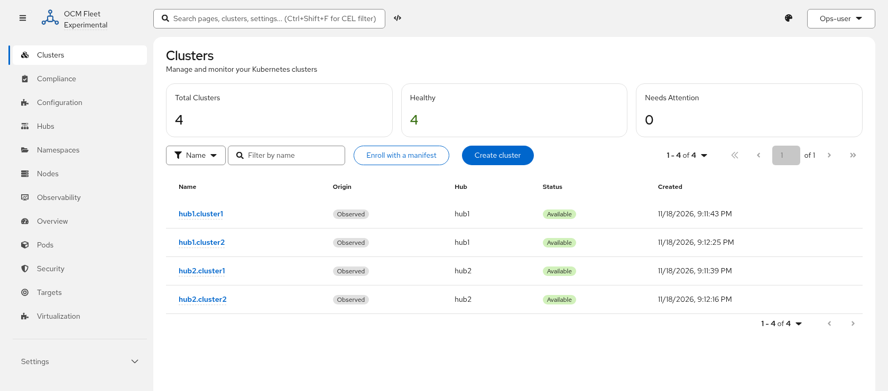

Type `cluster1` into the search box. It finds one on each hub.

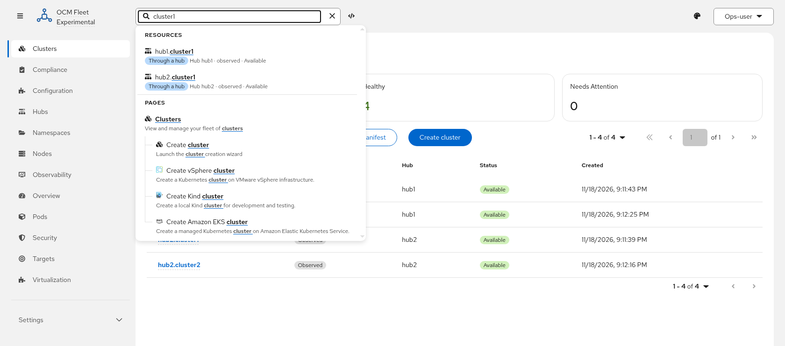

The account can read the hub's clusters and change nothing on the hub. Ask the hub itself:

```bash
READER=system:serviceaccount:ocm-fleet-hub-connection:ocm-fleet-hub-reader
kubectl --context hub2 auth can-i list managedclusters -A --as=$READER
kubectl --context hub2 auth can-i create manifestworks -n cluster1 --as=$READER
```

The answers are `yes` and `no`.

### 3. One cluster opts in

A managed cluster becomes a target of OCM Fleet through an OCM add-on. OCM Fleet writes the
add-on for a hub, and the hub's administrator applies it: OCM Fleet itself may only read the
hub. The administrator then enables the add-on for `cluster1`, the way any OCM add-on is
enabled.

```bash
fleetctl hub enrollment-addon --id hub1 --grant-platform-delivery > .work/hub1-enrollment-addon.yaml
kubectl --context hub1 apply -f .work/hub1-enrollment-addon.yaml
kubectl --context hub1 apply -f manifests/enable-cluster1.yaml
fleetctl hub list
```

The add-on is not a file of `manifests/`: OCM Fleet makes it for this one hub, and it carries
a secret that lets the clusters of that hub enroll. `--grant-platform-delivery` lets OCM
Fleet deliver deployments that are not signed, like the ones of this demo; without it nothing
would be delivered. The console makes the same add-on, as a download: **Hubs**, then
**Enroll clusters**.

`fleetctl hub list` counts one enrolled cluster for `hub1`; run the command again if the
count is still 0. In the console, open **Clusters** and press F5. `hub1.cluster1` is
**Enrolled** and **Ready**.

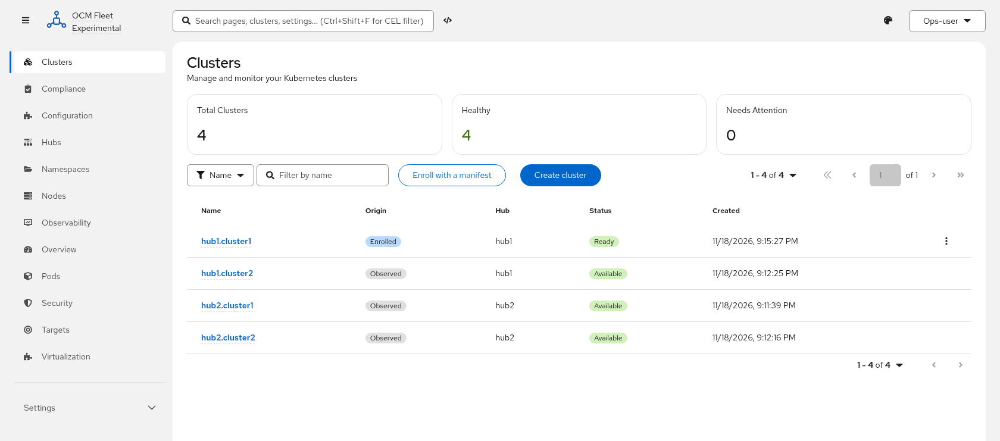

### 4. Deliver work to it

In OCM Fleet an enrolled cluster is the target `k8s-` plus its name.

```bash
fleetctl deployment create --id hello --resource-type kubernetes \
  --manifest-file manifests/hello.yaml --placement-type static --target-ids k8s-hub1.cluster1
kubectl --context hub1-cluster1 wait --for=create -n hello deployment/hello --timeout=120s
kubectl --context hub1-cluster1 -n hello rollout status deployment/hello
kubectl --context hub1-cluster1 -n hello get pods
kubectl --context hub1 get manifestworks -A
```

Two pods run on the cluster. The hub holds no ManifestWork for them, only the one that
installed the add-on: OCM Fleet delivered straight to the cluster.

In the console, open **Clusters**, click `hub1.cluster1`, open the tab **Pods**, and type
`hello` into the box **Filter by name**. OCM Fleet indexes what runs in an enrolled cluster,
and the index follows the cluster: press F5 if the two pods are not there yet or not yet
**Running**.

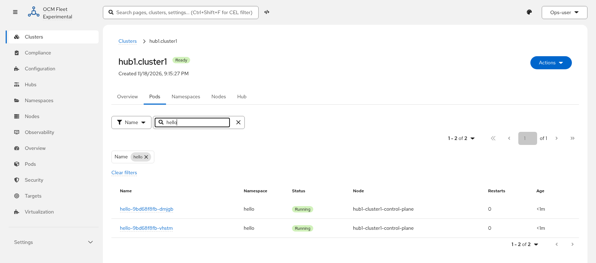

Type `hello` into the search box at the top.

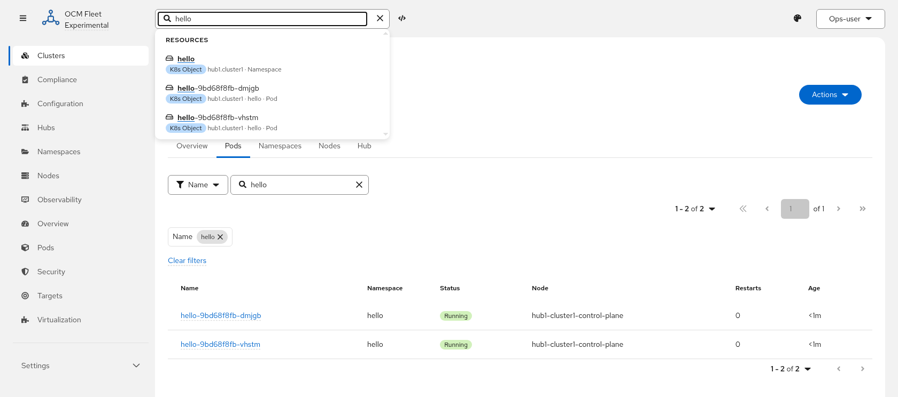

### 5. Every managed cluster becomes a target

Team A enables its second cluster the same way. Team B wants every cluster of its hub
enrolled, including clusters that join later. For that, its add-on follows an OCM Placement
that selects every cluster of the hub.

```bash
kubectl --context hub1 apply -f manifests/enable-cluster2.yaml
fleetctl hub enrollment-addon --id hub2 --rollout every-cluster --grant-platform-delivery \
  > .work/hub2-enrollment-addon.yaml
kubectl --context hub2 apply -f .work/hub2-enrollment-addon.yaml
fleetctl hub list
```

Both hubs count two enrolled clusters: all four managed clusters are targets. Run the
command again if a count is still lower. In the console, open **Hubs**, press F5, and open
the row of `hub2` with the arrow at its left end.

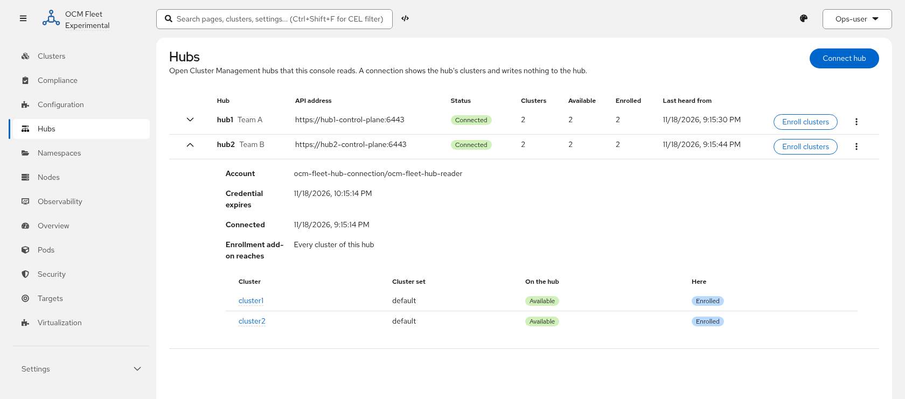

### 6. One deployment for clusters of both hubs

Deliver a workload by label instead of by cluster name. The hubs' administrators put the
label on the ManagedCluster, on their own hub.

```bash
fleetctl deployment create --id web --resource-type kubernetes \
  --manifest-file manifests/web.yaml --placement-type selector --target-selector env=prod
kubectl --context hub1 label managedcluster cluster1 env=prod
kubectl --context hub2 label managedcluster cluster1 env=prod
kubectl --context hub1-cluster1 wait --for=create -n web deployment/web --timeout=120s
kubectl --context hub2-cluster1 wait --for=create -n web deployment/web --timeout=120s
```

In the console, open **Targets**, press F5, and open the row `k8s-hub2.cluster1`. The target
has the labels of its ManagedCluster, and three that OCM Fleet adds: its hub, its cluster
set, and its name on the hub. (The fifth target, `kind-local`, comes with OCM Fleet's test
installation and is not part of the demo.)

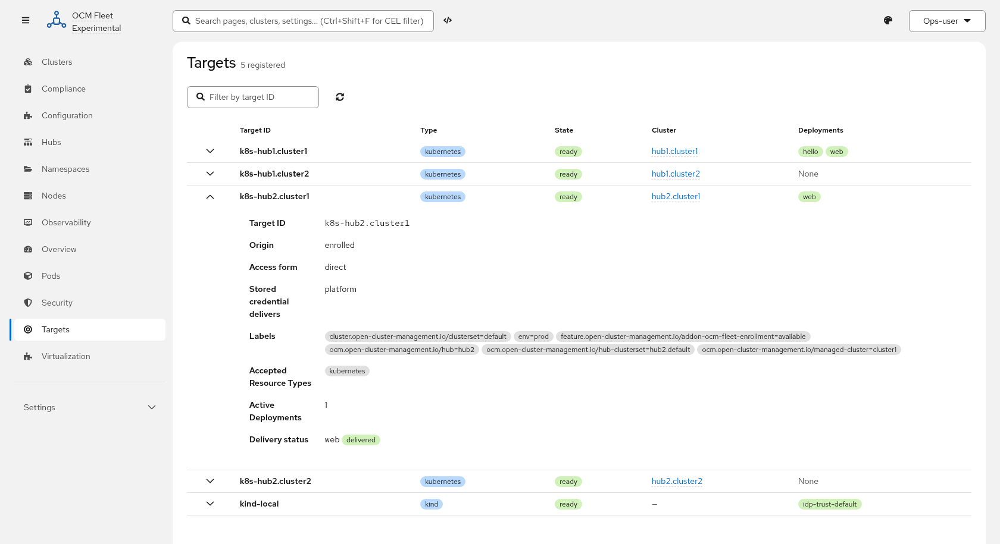

Label one more cluster on its hub, and the workload follows.

```bash
kubectl --context hub2 label managedcluster cluster2 env=prod
kubectl --context hub2-cluster2 wait --for=create -n web deployment/web --timeout=120s
```

Press F5: the row of `k8s-hub2.cluster2` names `web` too. Then type `web` into the search
box. One search finds the workload on three clusters of two hubs.

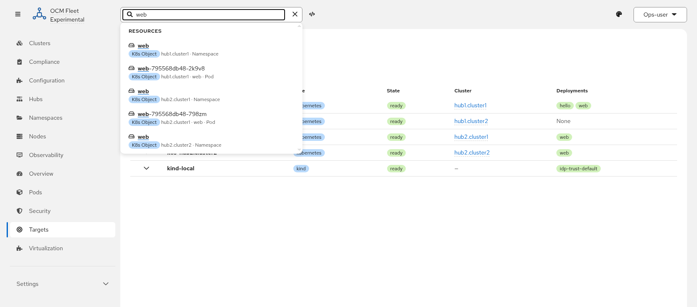

### 7. One cluster turns unhealthy

Stop OCM's agent, the klusterlet, on `cluster2` of `hub1`: the klusterlet's operator first, so
that nothing starts the agent again. The hub stops hearing from the cluster and then calls
it `Unknown`; the third command waits for that. (`setup.sh` set the clusters of this demo to
report to their hub more often than OCM's default, so that the hub notices sooner.)

```bash
kubectl --context hub1-cluster2 -n open-cluster-management scale deployment klusterlet --replicas=0
kubectl --context hub1-cluster2 -n open-cluster-management-agent scale deployment --all --replicas=0
kubectl --context hub1 wait managedcluster cluster2 --for=condition=ManagedClusterConditionAvailable=Unknown --timeout=180s
kubectl --context hub1 get managedclusters
fleetctl hub list
```

`fleetctl hub list` counts one available cluster for `hub1`; run the command again if it
still counts two. In the console, open **Hubs** and press F5. `hub1` has one available
cluster left, and the number is marked in orange.

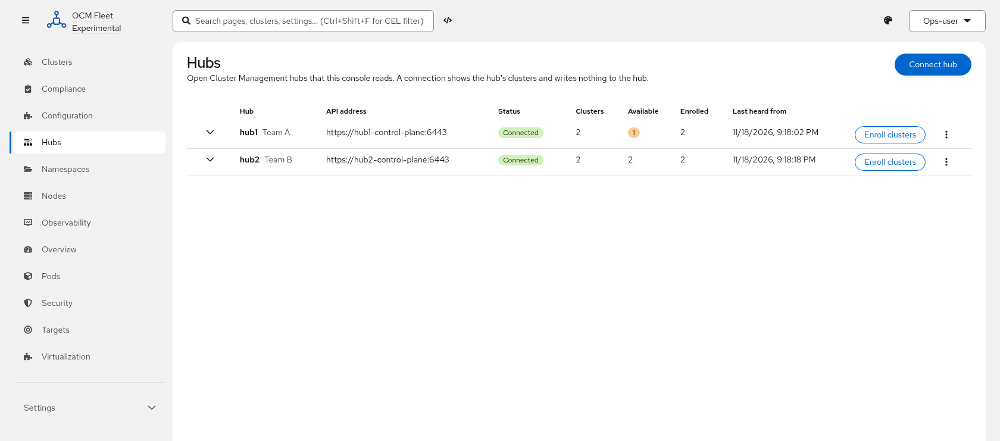

Open **Clusters**. `hub1.cluster2` reads **Ready** and **On its hub: Unknown**, and **Needs
Attention** counts it.

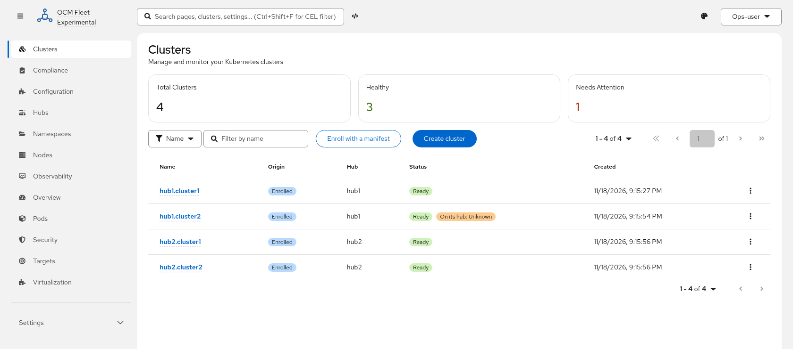

Click `hub1.cluster2`. The page gives the hub's reason and says that the cluster still answers.

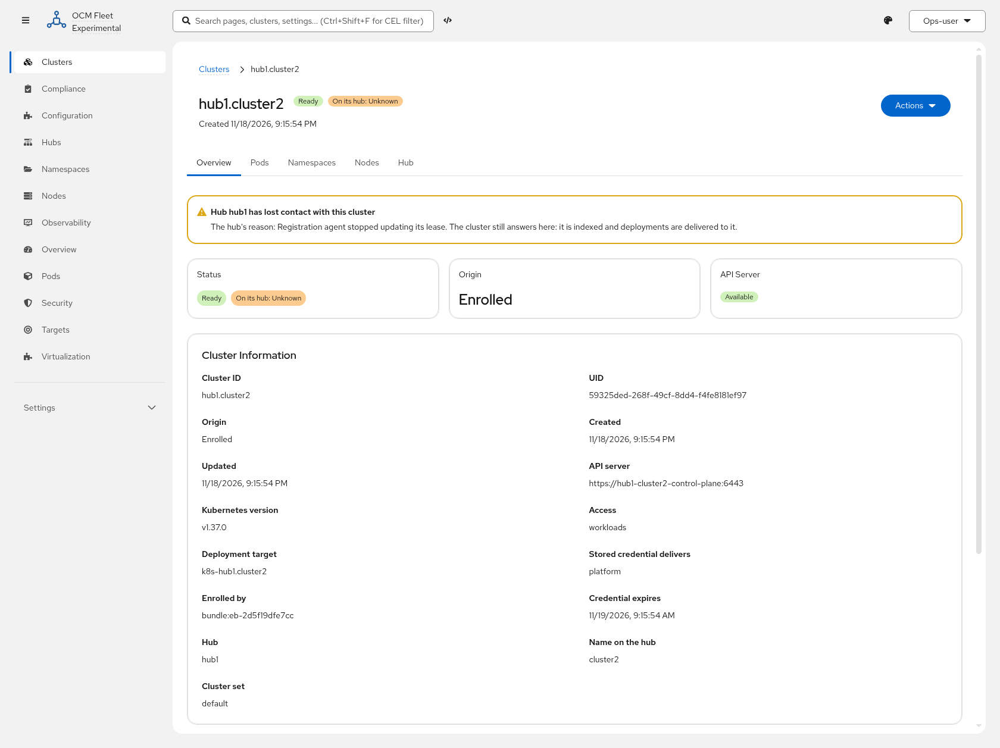

The hub cannot deliver to that cluster right now. OCM Fleet reaches the cluster itself, so it
still can:

```bash
fleetctl deployment create --id still-reachable --resource-type kubernetes \
  --manifest-file manifests/still-reachable.yaml --placement-type static --target-ids k8s-hub1.cluster2
kubectl --context hub1-cluster2 wait --for=create -n still-reachable configmap/note --timeout=120s
kubectl --context hub1-cluster2 -n still-reachable get configmap note -o jsonpath='{.data.written}{"\n"}'
```

Repair the cluster: start the operator again, and it starts the agent.

```bash
kubectl --context hub1-cluster2 -n open-cluster-management scale deployment klusterlet --replicas=1
kubectl --context hub1 wait managedcluster cluster2 --for=condition=ManagedClusterConditionAvailable=True --timeout=180s
```

### 8. Put everything back

```bash
scripts/reset.sh
```

It removes what the demo made, on the hubs, on the clusters, and in OCM Fleet, and ends with
`Ready`. It is safe at any moment, also in the middle of a demo that went wrong.

## If something goes wrong

| What you see                                                  | What to do                                                                                                   |
| ------------------------------------------------------------- | ------------------------------------------------------------------------------------------------------------ |
| A step went wrong and you want to start over                  | `scripts/reset.sh`, then begin again at step 1.                                                              |
| The machine was restarted                                     | `scripts/setup.sh`. It starts everything again and waits until OCM is back at work.                          |
| `kubectl` says `context was not found for specified context`  | The `export` line of "Before you start" was not run in this terminal.                                        |
| `kubectl` says the connection to `localhost:8080` was refused | The command has no `--context`.                                                                              |
| `fleetctl` says `fetch failed`                                | It cannot reach OCM Fleet: run the `export` line in this terminal, and `fleetctl auth setup` if not yet run. |
| `fleetctl` says `401 Unauthorized`                            | You are not signed in, or the sign-in has expired: run `fleetctl auth login` again.                          |
| `fleetctl auth login` says `callback timed out`               | The sign-in on the browser page was not finished before `fleetctl` stopped waiting: run the command again.   |
| `fleetctl deployment create` says `already exists`            | The deployment is left from an earlier demo: `scripts/reset.sh`.                                             |
| A page or a command does not show a change yet                | Press F5, or run the command again.                                                                          |

## What is in this folder

| Path           | What it is                                                                                                                                  |
| -------------- | ------------------------------------------------------------------------------------------------------------------------------------------- |
| `manifests/`   | What the steps apply: the read-only account for a hub, the two objects that enable the add-on for a cluster, and the three small workloads. |
| `screenshots/` | The pictures of this page.                                                                                                                  |
| `scripts/`     | `setup.sh` and `reset.sh` for the environment. `scripts/setup.sh down` deletes the clusters, the container of OCM Fleet, and `.work/`.      |
| `.work/`       | Made by `setup.sh` and by the steps, and not committed: the kubeconfig, CA certificates, logs, the sign-in of `fleetctl`, and the add-ons.  |

For more detail, with every request written out, see
[the walkthrough](../../deploy/aio/existing-clusters-walkthrough.md) and
[the API reference](../../docs/existing-clusters-api.md).
